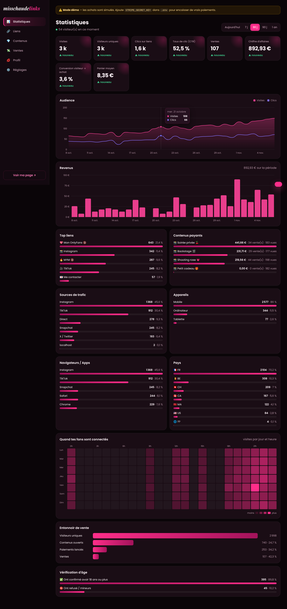
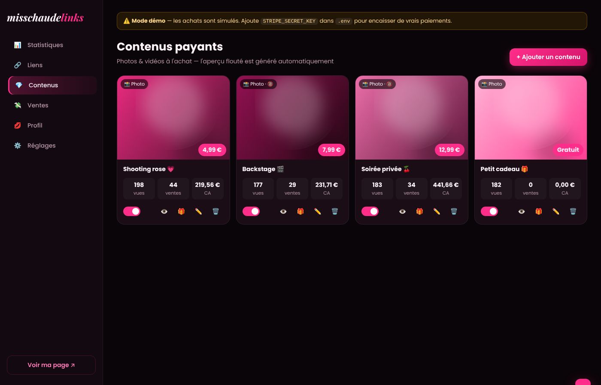

# 💋 misschaudelinks

Page de liens façon Linktree pour **misschaudex** — noir & rose, animée — avec **vente de photos et de vidéos**, **statistiques détaillées**, **interface admin complète** et **vérification d'âge 18+** sur les liens et contenus de ton choix.

| Page publique | Tableau de bord admin | Contenus payants |
|---|---|---|
|  |  |  |

## Démarrage

```bash
cd misschaudelinks
npm install
npm run seed     # (optionnel) liens, contenus et 30 jours de stats de démo
npm start        # http://localhost:3000  — admin : http://localhost:3000/admin
```

Node.js **22.13 ou plus récent** est requis (la base SQLite est intégrée à Node, rien à installer).
À la première visite de `/admin`, tu choisis ton mot de passe administrateur.

## Configuration (`.env`)

Copie `.env.example` en `.env` :

| Variable | Rôle |
|---|---|
| `PORT` | Port HTTP (3000 par défaut) |
| `PUBLIC_URL` | URL publique du site, ex. `https://misschaudelinks.com` (sert aux retours de paiement) |
| `STRIPE_SECRET_KEY` | Clé secrète Stripe pour encaisser de vrais paiements. **Vide = mode démo** (achats simulés) |
| `CURRENCY` | Devise (`eur` par défaut) |
| `COOKIE_SECRET` | Secret de signature des cookies (généré automatiquement si absent) |

## Fonctionnalités

**Page publique**
- Avatar avec anneau rose animé, nom en dégradé scintillant, bio, icônes réseaux sociaux
- Liens animés (apparition en cascade, reflet au survol, effet d'onde au clic, lien « mis en avant » qui pulse)
- Fond animé : halos roses flottants + paillettes
- **18+** : badge sur les liens/contenus concernés, fenêtre de vérification d'âge avant ouverture ; option pour protéger **toute la page**
- **Boutique** : photos/vidéos avec aperçu flouté + cadenas, achat en 1 clic, déblocage animé (pluie de cœurs), visionneuse plein écran
- « Mes achats » : lien de récupération pour retrouver ses contenus sur un autre appareil

**Admin** (`/admin`, adapté mobile)
- **Statistiques** sur aujourd'hui / 7 j / 30 j / 90 j / 1 an, comparées à la période précédente : visites, visiteurs uniques, clics, CTR, ventes, CA, conversion, panier moyen, visiteurs en direct ; courbes d'audience et revenus avec infobulles ; top liens, top contenus, sources (Instagram, TikTok, Snapchat…), appareils, navigateurs/apps, pays ; carte de chaleur jour × heure ; entonnoir de vente ; stats de vérification d'âge ; export CSV
- **Liens** : ajout/modification, icônes emoji, sous-titre, 18+, mise en avant, masquer/afficher, programmation (début/fin), réordonnancement par glisser-déposer, clics par lien
- **Contenus** : upload photo/vidéo par glisser-déposer avec barre de progression, prix, 18+, flou réglable — l'aperçu flouté est généré automatiquement ; vues/ventes/CA par contenu ; offrir un accès gratuit (lien cadeau)
- **Ventes** : historique, recherche, lien d'accès de l'acheteur, remboursement (Stripe), export CSV
- **Profil** : photo, nom, bio, couleur d'accent, réseaux sociaux, aperçu en direct sur téléphone
- **Réglages** : mot de passe, état des paiements, exports

## Sécurité
- Les fichiers originaux sont stockés hors du dossier public et servis **uniquement** aux acheteurs (cookie signé) ou à l'admin ; le public ne voit qu'un aperçu flouté réduit.
- Mot de passe admin haché (scrypt), sessions httpOnly, limitation des tentatives de connexion.
- Toutes les données sont dans `data/` (base SQLite + fichiers) : **sauvegarde ce dossier**.

> La vérification d'âge est une déclaration sur l'honneur. Selon ton pays et les plateformes où tu partages ce lien, une vérification renforcée peut être exigée pour les contenus adultes.
